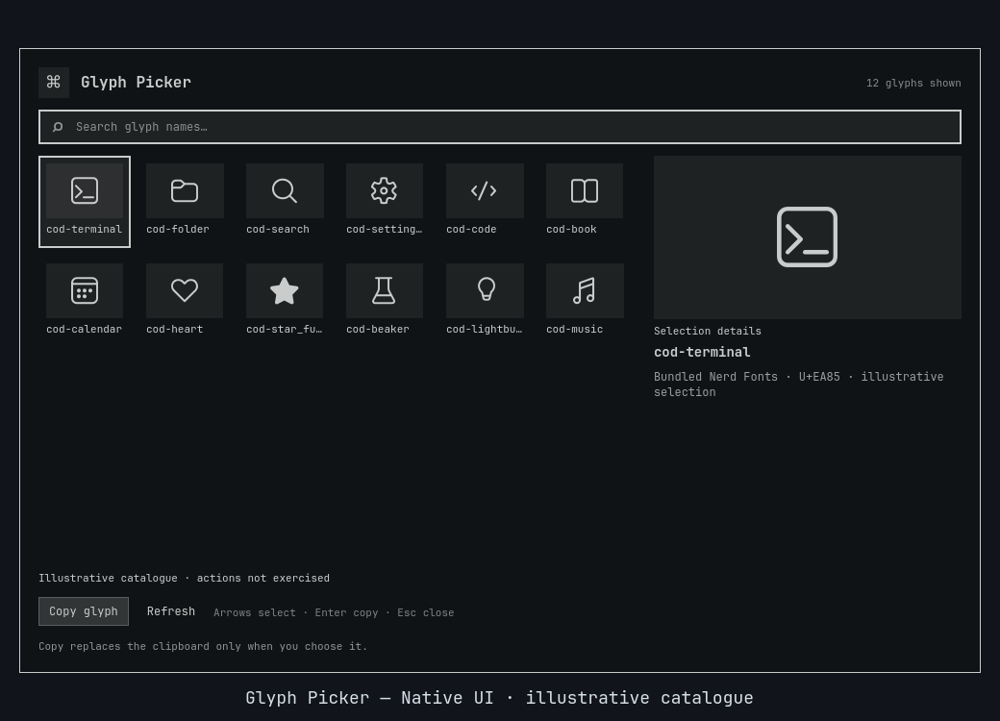

# Glyph Picker

**The right symbol, one deliberate copy.**

Search **10,757 bundled Nerd Fonts mappings**, inspect the selected symbol and code point, then copy the glyph or its `U+…` text. Keep your prompt icons, status symbols and everyday favorites within reach, without a clipboard-history tool.

[](https://github.com/Battlelamb/omarchy-glyph-picker/actions/workflows/ci.yml)
[](LICENSE)

[Install](#install-and-open) · [Controls](#controls) · [Preferences](#make-it-yours) · [Limits](#limits-and-safety) · [Backend reference](BACKEND.md)

> **v0.3.0 · development/testing snapshot.** This is a source publication, not a stable release. Live open/close checks have passed; current clipboard actions and full-shell upgrade/rollback remain unqualified.



*Historical native Qt/Quickshell capture from an isolated headless compositor: 12 illustrative symbols, `cod-terminal` selected. Actions were not exercised. This is not a v0.3.0 feature demonstration or the full bundled catalogue. [Preview provenance](docs/PREVIEW.md).*

## From a name to a useful symbol

| When you need… | Use… |
| :--- | :--- |
| An icon for a script, prompt or config | Name search, a glyph grid and selected code-point details |
| A narrower starting point | **Configure → Named collection**: developer, arrows, media, weather or status |
| The actual character | **Copy** or **Enter** on the selection |
| A textual Unicode reference | **More → copy codepoint**, for text such as `U+EA60` |
| A set you use repeatedly | Favorites, Recent and your own named collections |

Named collections are deterministic name-based filters, not exhaustive semantic categories. Aliases remain separate mappings. The bundle contains metadata, **not a font**: install a compatible Nerd Font separately for rendering.

## Install and open

Requires **Omarchy Quattro** with compatible Quickshell/Qt, `qs.Ui` and `qs.Commons`, system Python 3, GNU `timeout`, and `wl-copy` from `wl-clipboard` for copying. No companion plugin, hub or extra service is required.

Review the source before enabling this testing snapshot:

```sh
omarchy plugin add https://github.com/Battlelamb/omarchy-glyph-picker.git --enable
omarchy-shell shell summon leviathan.glyph-picker
```

<details>
<summary><strong>Optional: Super+Space → Trigger → Glyph Picker</strong></summary>

Installation does **not** add a menu entry or hotkey. Back up `~/.config/omarchy/extensions/omarchy-menu.jsonc`, then merge this entry into its existing top-level object. Preserve your other entries and add the necessary comma between siblings. If the file does not exist, this is a complete starting object:

```jsonc
{
  "trigger.glyph-picker": {
    "label": "Glyph Picker",
    "action": "omarchy-shell shell summon leviathan.glyph-picker"
  }
}
```

The `trigger.` prefix places it under the native **Trigger** category. Do not replace the stock menu or your existing extension file.

</details>

## Controls

| Input or control | Result |
| :--- | :--- |
| Type while the catalogue has focus | Filter by name or code-point detail |
| Arrow keys | Move through the grid |
| Home / End | Select the first / last match |
| Click a tile | Select only, without copying |
| Enter / primary Copy button | Request a copy of the selected glyph |
| More | Copy the code point, toggle Favorite or manage collections |
| View selector | Open All items, Favorites, Recent or a personal collection |
| Refresh | Reread the local catalogue |
| Esc / outside click | Dismiss; Esc from Configure returns to the catalogue |

## Make it yours

Open **Configure**, choose the saved view, personal collection and named collection, then select **Save settings**. Filters intersect: a favorite outside the selected named collection will not appear.

For a personal set, select a glyph, open **More**, enter a **Collection name** and choose **Add/remove item**. Select that collection from the view selector later. **Delete collection** removes the group, not its glyphs. Recent records only selections whose copy helper exited successfully, not clipboard contents.

Preferences survive source updates at:

```text
$XDG_CONFIG_HOME/omarchy/lego/glyph-picker/preferences.json
```

If `XDG_CONFIG_HOME` is unset or relative, the fallback is `~/.config/omarchy/lego/glyph-picker/preferences.json`. **Configure → Reset preferences** clears only this plugin's options, favorites, recent IDs and personal collections. It does not change fonts or clear the clipboard.

## Limits and safety

- **Copy replaces the clipboard only when requested.** There is no clipboard reading, history capture, automatic paste, font installation or download.
- Copying revalidates the selected ID against the bundled mapping. Saved names and IDs are data, not commands; the helper receives literal arguments, with no shell evaluation.
- Helper acceptance is not proof of live clipboard ownership. Closing the panel cannot undo an accepted copy, and there is no Restore. The runtime is not itself a sandbox.
- New preference saves have a **128 KiB aggregate budget**. A rejected save preserves the existing file. A later Recent-save or optional-snapshot warning does not reverse a confirmed copy.
- Mapping rights do not establish rights to every rendered font design. Font and component licenses remain separate; see the [mapping notice](NOTICE.backend.md).

<details>
<summary><strong>Verification and troubleshooting</strong></summary>

The shipped offline suite uses a fake HOME and controlled clipboard helpers. Native component tests are offscreen fixtures, not live clipboard integration. Historical preview and earlier-version checks do not qualify the new saved-state features. See [validation notes](docs/VALIDATION.md) and [CI scope](docs/CI.md); the badge links to the actual hosted workflow status.

From a checkout, using an existing private scratch directory as `TMPDIR`:

```sh
env -u PYTHONPATH PATH=/usr/bin /usr/bin/python3 scripts/run-tests.py --backend-only
env -u PYTHONPATH PATH=/usr/bin bash test.sh
```

The backend runner needs `bwrap`; the full suite also needs Node.js and the native Qt/Quickshell test dependencies. These commands do not establish full-shell upgrade/rollback, long-soak, all-scale or accessibility qualification.

| Symptom | Check |
| :--- | :--- |
| Empty squares instead of symbols | Install a Nerd Font with the required mappings; rendering depends on your font setup |
| No matches | Clear the query and intersecting saved filters, then Refresh |
| Copy unavailable or rejected | Check `wl-copy` and your Wayland session separately |
| Preference error | Preserve the file before troubleshooting; corrupt stores are reported, not silently overwritten |

The [backend reference](BACKEND.md) documents the exact CLI, filter rules, storage limits and explicit `--apply` write boundary.

</details>

<details>
<summary><strong>Disable or remove</strong></summary>

```sh
omarchy plugin disable leviathan.glyph-picker
omarchy plugin remove leviathan.glyph-picker
```

If you added the optional menu entry, remove that entry separately. Use Reset first if you want this plugin's saved preferences cleared.

</details>

---

Independent community plugin, not an official Omarchy or HyDE release. Original code: **GPL-3.0-only**. Nerd Fonts mapping metadata retains its **MIT** notice; no font binary is bundled. [License](LICENSE) · [Source notices](NOTICE.md) · [Mapping provenance](runtime/0.3.0/data/provenance.json) · [Contributing](CONTRIBUTING.md) · [Security](SECURITY.md)
